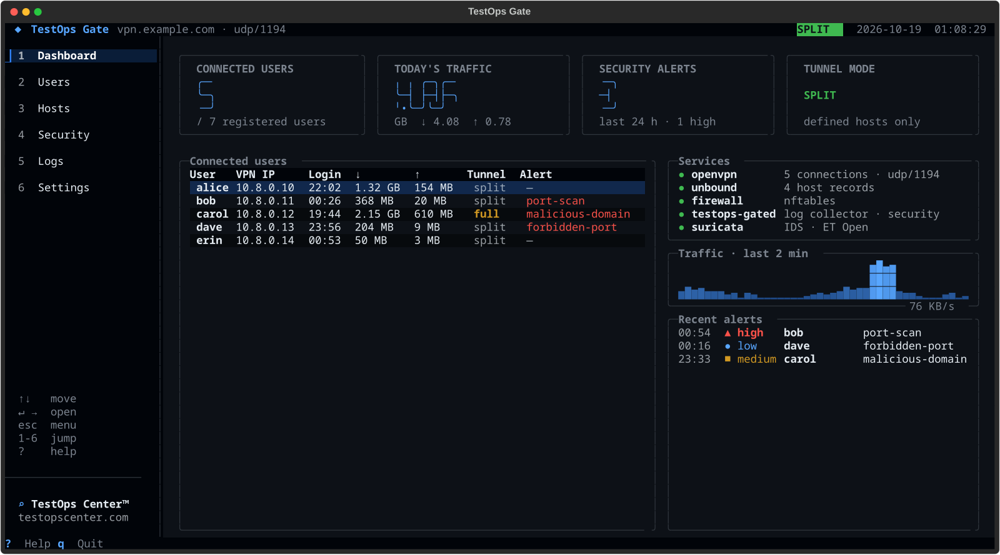

<p align="center">
  <a href="https://testopscenter.com">
    <picture>
      <source media="(prefers-color-scheme: dark)" srcset="docs/assets/logo-white.png">
      
    </picture>
  </a>
</p>

<h1 align="center">TestOps Gate</h1>

<p align="center">
  A private OpenVPN network for your team, managed from a terminal dashboard.<br>
  <a href="https://testopscenter.com">TestOps Center</a> · <a href="LICENSE">AGPL-3.0</a> · Debian 12/13 · Ubuntu 22.04/24.04
</p>

<p align="center">
  
</p>

## Features

- **VPN users** — one command or one form per user; fixed VPN address, `.ovpn` profile, disable / renew / delete.
- **Internal DNS** — map names to private addresses (`stage.internal → 10.0.5.20`, wildcards, CNAMEs).
- **Split or full tunnel** — only your internal hosts over the VPN, or all traffic; globally or per user.
- **Per-user logs** — sessions, DNS queries and connections in `/var/log/testops-gate/users/<user>/`, kept 14 days.
- **Security monitoring** — port scans, blocked networks, forbidden ports, malicious domains, Suricata IDS, unusual upload volume, failed logins.
- **Alerts** — Slack and email, with severity thresholds and muting.
- **Dashboard** — keyboard-driven terminal UI in English and Turkish; everything is also available from the CLI.

## Install

On a fresh Debian 12/13 or Ubuntu 22.04/24.04 server:

```bash
curl -fsSL https://testopscenter.com/install.sh | sudo sh
```

The script downloads the package, verifies its checksum, installs it and opens the setup wizard.
For an unattended setup, pass the options to `testops-gate install`:

```bash
curl -fsSL https://testopscenter.com/install.sh | sudo sh -s -- \
    --endpoint vpn.example.com --user alice --yes
```

Open UDP port **1194** (or the port you choose) in your cloud firewall.

## Usage

```bash
sudo testops-gate                                   # dashboard
```

Or from the command line:

```bash
sudo testops-gate user add alice --email alice@example.com
sudo testops-gate user export alice > alice.ovpn     # import into any OpenVPN client
sudo testops-gate host add stage.internal 10.0.5.20
sudo testops-gate tunnel set full                    # or: split
sudo testops-gate notify add slack --name '#vpn-alerts' --webhook https://hooks.slack.com/services/…
sudo testops-gate logs alice --since 2h
sudo testops-gate status
```

Run `testops-gate --help` or `testops-gate <command> --help` for all options.

## Update and uninstall

```bash
sudo testops-gate update            # also from the dashboard: Settings → Updates
sudo testops-gate uninstall         # removes everything; --keep-data keeps certificates, users and logs
```

The dashboard shows a badge when a new version is available. Updates verify the package checksum
and back up the configuration first; users, certificates and settings are kept.

## Documentation

- [Detailed guide (Turkish)](docs/GUIDE.tr.md) — architecture, tunnel modes, DNS, logs, security categories, notifications, files
- [Releasing](docs/RELEASING.md) — build, test and publish a version

## License

TestOps Gate is free software, licensed under the [GNU Affero General Public License v3.0 or later](LICENSE).
Copyright © 2026 Halis Utku Aladağ ([NOTICE](NOTICE)).

"TestOps Center" and its logo and icon are trademarks and are not covered by the license; see [TRADEMARKS.md](TRADEMARKS.md).
