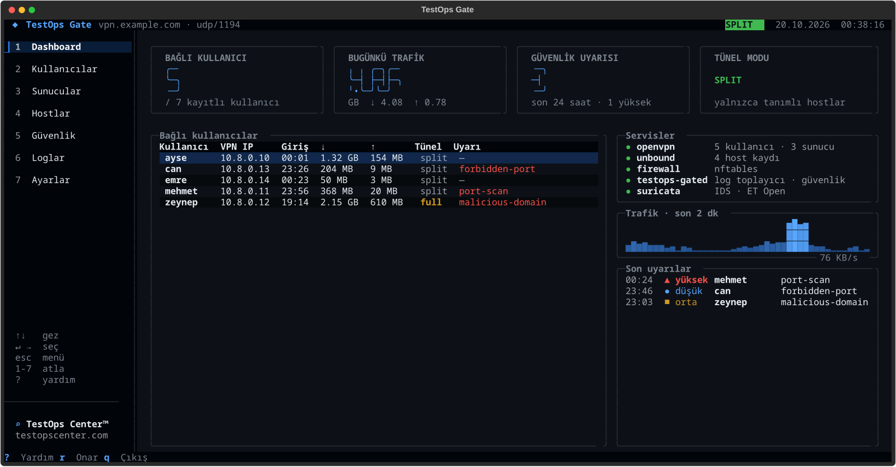
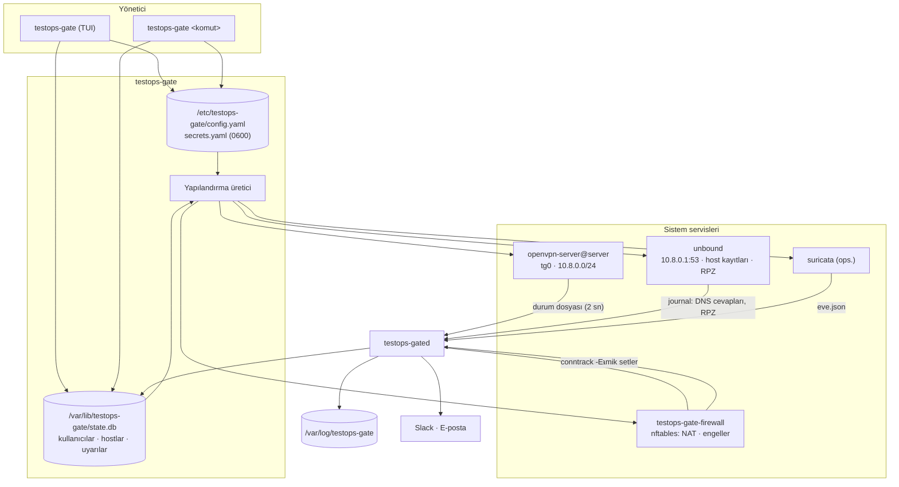
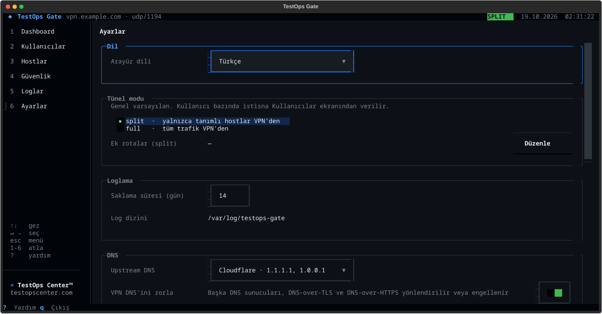
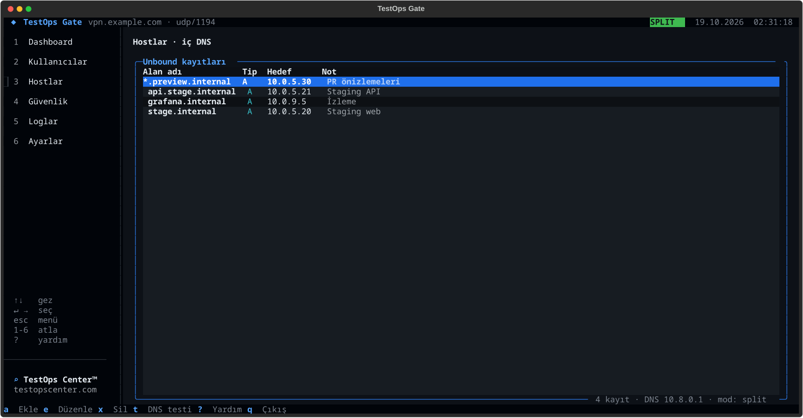
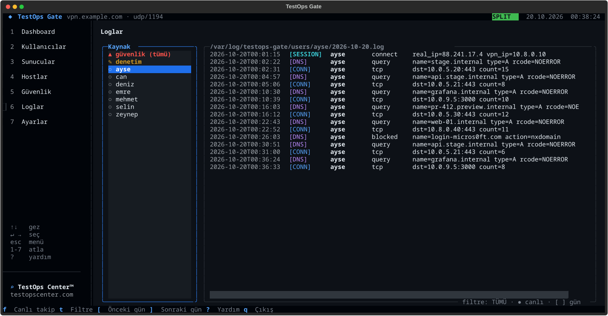
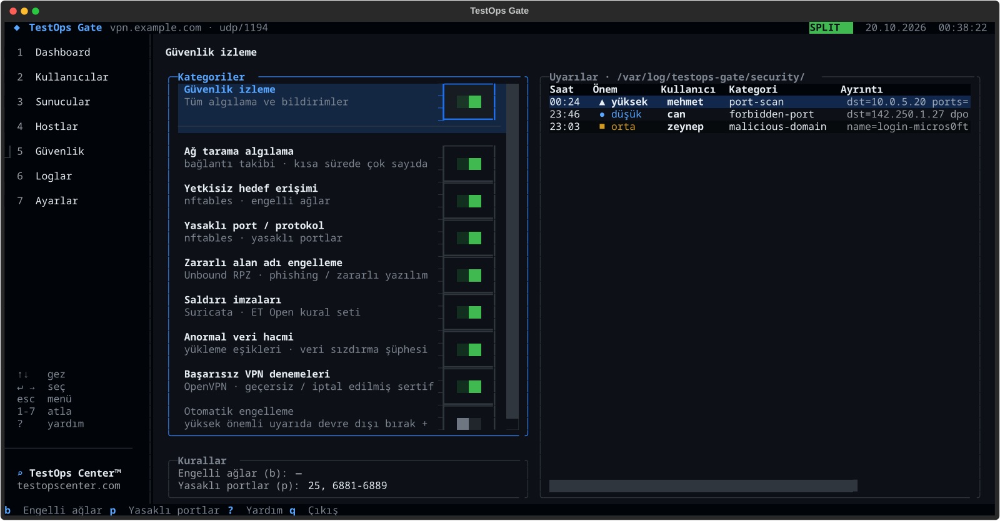
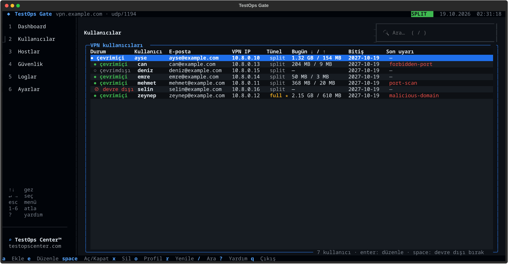

<p align="center">
  <a href="https://testopscenter.com">
    <picture>
      <source media="(prefers-color-scheme: dark)" srcset="assets/logo-white.png">
      
    </picture>
  </a>
</p>

<h1 align="center">TestOps Gate · Kullanım kılavuzu</h1>

<p align="center">
  <a href="https://testopscenter.com">TestOps Center</a> ·
  <a href="../LICENSE">AGPL-3.0</a> ·
  Debian 12+ · Ubuntu 22.04+ · amd64 / arm64
</p>

OpenVPN tabanlı özel ağ: tek komutla kurulur, terminal arayüzünden (TUI) veya komut satırından yönetilir.

- **VPN kullanıcıları:** sabit VPN IP'si, kullanıcı bazında split/full tünel, devre dışı bırakma, sertifika yenileme
- **İç DNS:** `stage.internal → 10.0.5.20` gibi host kayıtları (Unbound), wildcard ve CNAME desteği
- **Kullanıcı bazlı loglar:** oturum, DNS sorgusu ve bağlantılar; `/var/log/testops-gate/users/<kullanıcı>/`, varsayılan 14 gün
- **Güvenlik izleme:** port tarama, engelli ağlar, yasaklı portlar, zararlı alan adları (RPZ), Suricata IDS, anormal veri hacmi, başarısız bağlantılar
- **Bildirimler:** Slack ve e-posta; kanal bazında minimum önem ve susturma süresi
- **Arayüz dili:** İngilizce (varsayılan) ve Türkçe

Desteklenen sistemler: **Debian 12 ve üstü, Ubuntu 22.04 ve üstü** (LTS ve ara sürümler) ile bunlardan türeyen dağıtımlar
(Raspberry Pi OS, Linux Mint, Pop!_OS…). Paket mimariden bağımsızdır: amd64, arm64, armhf ve diğerleri.
Debian 12/13 ve Ubuntu 22.04/24.04/25.10/26.04 her sürümde test edilir; diğerlerinde kurulum "test edilmedi" notu gösterir.

<p align="center"></p>

---

## Kurulum

```bash
curl -fsSL https://testopscenter.com/install.sh | sudo sh
```

`install.sh` son sürümün `.deb` paketini `testopscenter.com`'dan indirir, SHA-256 sağlamasını doğrular, `apt` ile kurar ve kurulum sihirbazını açar. Sihirbaz sorar: dış adres (otomatik algılanır), port, protokol, tünel modu, upstream DNS, güvenlik izleme, Suricata, ilk kullanıcı. Kurulumdan sonra `sudo testops-gate` dashboard'u açar.

Etkileşimsiz kurulum (argümanlar `testops-gate install`'a geçer):

```bash
curl -fsSL https://testopscenter.com/install.sh | sudo sh -s -- \
    --endpoint vpn.example.com --mode split --user ayse --email ayse@example.com --yes
```

| Ortam değişkeni | Açıklama |
|---|---|
| `TESTOPS_GATE_VERSION` | Belirli bir sürüm, ör. `0.1.1` (varsayılan: son sürüm) |
| `TESTOPS_GATE_RELEASES` | Sürüm deposunun kökü (altında `latest/` ve `v<sürüm>/` olan bir ayna) |
| `TESTOPS_GATE_BASE_URL` | Doğrudan bir dizinden indir (`testops-gate_all.deb` + `SHA256SUMS` barındıran bir adres) |
| `NO_COLOR` | Renksiz çıktı |

Paketi elle kurmak da mümkün: `sudo apt install ./testops-gate_0.1.1_all.deb && sudo testops-gate`.

| Seçenek | Varsayılan | Açıklama |
|---|---|---|
| `--endpoint` | algılanır | İstemcilerin bağlanacağı IP / alan adı |
| `--port`, `--protocol` | `1194`, `udp` | |
| `--mode` | `split` | `split`: yalnızca tanımlı hostlar VPN'den · `full`: tüm trafik |
| `--dns` | `cloudflare` | `cloudflare`, `quad9`, `google`, `adguard`, `recursive` |
| `--language` | `en` | `en`, `tr` |
| `--no-security` | | Güvenlik izlemeyi kapalı kur |
| `--no-ids` | | Suricata'yı kurma (≈400 MB RAM tasarrufu) |
| `--user`, `--email` | | İlk VPN kullanıcısı |

## Güncelleme

Yeni sürüm çıktığında dashboard'un üst çubuğunda **⬆ vX.Y.Z** rozeti görünür. **Ayarlar → Güncellemeler** bölümünde kurulu ve son sürüm, son kontrol zamanı, "Her gün güncelleme kontrol et" anahtarı ve **Güncelle** butonu bulunur. Komut satırından:

```bash
sudo testops-gate update --check     # yalnızca kontrol et
sudo testops-gate update             # indir, doğrula, yedekle, kur
```

Güncelleme sırasında:

1. `testops-gate_all.deb` indirilir ve `SHA256SUMS` ile doğrulanır (uyuşmazsa kurulmaz).
2. `/etc/testops-gate` ve `state.db` yedeklenir: `/var/lib/testops-gate/backups/` (son 5 yedek).
3. Paket `apt` ile kurulur; paket betiği yapılandırmayı yeni sürüme göre yeniden üretir (`testops-gate apply`) ve `testops-gated`'yi yeniden başlatır. Kullanıcılar, sertifikalar, hostlar, ayarlar ve loglar korunur; OpenVPN yalnızca `server.conf` değiştiyse yeniden başlar.
4. Dashboard'dan başlatıldıysa dashboard yeni sürümle yeniden açılır.

Sürüm bilgisi `https://testopscenter.com/testops-gate/latest/VERSION` dosyasından okunur (günde en fazla bir kez; `testops-gated` de kontrol eder). Kendi sunucunuzdan dağıtıyorsanız: `sudo testops-gate settings update-url https://ornek.com/testops-gate` (`VERSION`, `testops-gate_all.deb`, `SHA256SUMS` barındıran bir adres). Kontrolleri kapatmak için: `sudo testops-gate settings update-check off`. `curl -fsSL https://testopscenter.com/install.sh | sudo sh` komutunu tekrar çalıştırmak da güncelleme yapar.

## Kaldırma

```bash
sudo testops-gate uninstall             # her şeyi kaldırır
sudo testops-gate uninstall --keep-data         # sertifikalar, kullanıcılar ve loglar kalır
sudo testops-gate uninstall --keep-packages     # OpenVPN, Unbound, … ve testops-gate paketi kalır
```

Dashboard'da: **Ayarlar → Kaldır…** (iki seçenek de varsayılan olarak açık; onay için `uninstall` / `kaldır` yazılır).

`testops-gate uninstall` şunları kaldırır:

- servisler (OpenVPN, testops-gated, firewall, Suricata) ve üretilen yapılandırma, nftables tablosu, sysctl ayarı
- `/etc/testops-gate` (PKI dahil), `/var/lib/testops-gate`, `/var/log/testops-gate` — `--keep-data` ile korunur
- `testops-gate install`'ın kurduğu paketler (ör. Suricata) ve son adımda `apt purge --autoremove testops-gate` ile paketin kendisi ve onunla gelen bağımlılıklar — `--keep-packages` ile korunur

Kurulumdan **önce** sistemde olan paketlere (ör. zaten kullandığınız Unbound) dokunulmaz: kurulum yalnızca eksik paketleri kurar ve bunları `config.yaml` → `installed_packages` içine yazar.

---

## Mimari



**Temel fikir:** Her kullanıcının `ccd` dosyasında sabit bir VPN adresi vardır. Bu sayede DNS, firewall, conntrack ve IDS olaylarındaki kaynak IP doğrudan kullanıcıya eşlenir. Tünel modu, rotalar ve devre dışı bırakma da aynı dosyadadır; değişiklikler OpenVPN'i yeniden başlatmadan, kullanıcının bir sonraki bağlantısında uygulanır.

### Bileşenler

| Bileşen | Görev |
|---|---|
| `testops-gate` | TUI (argümansız) ve CLI |
| `testops-gated` | Log toplayıcı ve güvenlik motoru (systemd servisi) |
| `openvpn-server@server` | VPN; `/etc/openvpn/server/server.conf`, `ccd/` |
| `unbound` | VPN istemcilerinin DNS'i; `/etc/unbound/unbound.conf.d/testops-gate*.conf` |
| `testops-gate-firewall` | `table inet testops_gate` (NAT, engelli ağlar, yasaklı portlar) |
| `suricata` (ops.) | `tg0` arayüzünde IDS, ET Open kuralları (günlük güncellenir) |

---

## Tünel modu

| | `split` (varsayılan) | `full` |
|---|---|---|
| VPN'den geçen | DNS + tanımlı hostlar + ek rotalar | Tüm trafik |
| Loglanan bağlantılar | İç hostlar | İnternet dahil hepsi |

- Genel mod: Ayarlar ekranı veya `testops-gate tunnel set split|full`
- Kullanıcı istisnası: kullanıcı formu veya `testops-gate user edit ayse --mode full`
- Ek ağlar (split): `testops-gate tunnel routes 10.0.0.0/16`
- Değişiklik kullanıcı yeniden bağlandığında uygulanır.

<p align="center"></p>

## Host tanımlama (iç DNS)

```bash
testops-gate host add stage.internal 10.0.5.20 --note "staging web"
testops-gate host add '*.preview.internal' 10.0.5.30      # tüm alt alan adları
testops-gate host add db.stage.internal pg.internal --type CNAME
```

VPN kullanıcıları `stage.internal` adresine gittiğinde Unbound `10.0.5.20` döner; split modda bu IP'ye rota otomatik olarak gönderilir. Kayıt değişiklikleri Unbound yeniden yüklenince anında geçerli olur.

> `stage.com` gibi gerçek bir alan adı da tanımlanabilir, ancak iç kullanım için `.internal` (bu amaçla ayrılmış) veya şirket alan adınızın bir alt alanı önerilir.

<p align="center"></p>

### VPN DNS'ini zorlama

Varsayılan olarak açık (`testops-gate settings dns-enforce on|off`, Ayarlar → DNS). Kullanıcı cihazında başka bir DNS ayarlasa da host kayıtları, DNS logları ve zararlı alan adı engeli çalışmaya devam eder:

- VPN'den gelen, herhangi bir sunucuya giden DNS (53) sorguları Unbound'a yönlendirilir (`dig @8.8.8.8 stage.internal` → `10.0.5.20`).
- DNS-over-TLS (853) ve bilinen DNS-over-HTTPS sunucularına (Cloudflare, Google, Quad9, AdGuard, …) 443 bağlantıları reddedilir; tarayıcılar normal DNS'e döner. Firefox'un DoH kontrol alanı (`use-application-dns.net`) NXDOMAIN döner.
- Split modda bu genel DNS sunucularının adreslerine VPN üzerinden rota gönderilir, böylece trafikleri sunucuya ulaşır.

## Loglar

```
/var/log/testops-gate/
├── testops-gate.log                   testops-gated
├── audit/2026-10-18.log              kim, ne zaman, ne değiştirdi
├── security/2026-10-18.log           tüm güvenlik uyarıları
└── users/ayse/
    ├── 2026-10-18.log                oturum + DNS + bağlantılar
    └── security-2026-10-18.log       bu kullanıcının uyarıları
```

```
2026-10-18T10:03:11+03:00 [SESSION]  ayse       connect    real_ip=88.1.2.3 vpn_ip=10.8.0.10
2026-10-18T10:03:14+03:00 [DNS]      ayse       query      name=stage.internal type=A rcode=NOERROR
2026-10-18T10:03:14+03:00 [CONN]     ayse       tcp        dst=10.0.5.20 dport=443 count=12
2026-10-18T10:41:07+03:00 [SECURITY] ayse       port-scan            severity=high dst=10.0.5.20 ports=100 hosts=1 window=60s
2026-10-18T11:20:05+03:00 [SESSION]  ayse       disconnect duration=1h16m rx=320.4MB tx=12.1MB
```

- Aynı hedefe 30 saniye içindeki bağlantılar tek satırda birleştirilir (`count=`).
- Saklama süresi varsayılan **14 gün**; `testops-gate settings retention 30`. Eski dosyaları `testops-gated` saatlik siler.
- HTTPS içeriği görülemez; loglanan: hedef IP/port ve DNS sorgusu.
- **KVKK:** kullanıcı bazlı trafik kaydı kişisel veridir. Kullanıcıları bilgilendirin; log dizini yalnızca root ve `testops-gate` grubu tarafından okunabilir.

```bash
testops-gate logs ayse                      # bugün
testops-gate logs ayse --since 2h --kind dns
testops-gate logs ayse --security -f        # canlı takip
testops-gate logs security --day 2026-10-17
testops-gate logs audit
```

<p align="center"></p>

## Güvenlik izleme

| Kategori (`testops-gate security …`) | Uyarı | Algılayan | Önem |
|---|---|---|---|
| `scan` | `port-scan` | conntrack: 60 sn'de ≥100 farklı host/port | yüksek |
| `unauth` | `unauthorized-target` | nftables: `block-networks` listesine erişim (engellenir) | orta |
| `ports` | `forbidden-port` | nftables: `forbidden-ports` (varsayılan 25, 6881-6889; engellenir) | düşük |
| `rpz` | `malicious-domain` | Unbound RPZ (varsayılan URLhaus listesi; NXDOMAIN döner) | orta |
| `ids` | `ids-signature` | Suricata, ET Open | imzaya göre |
| `volume` | `abnormal-volume` | 10 dk'da ≥2 GB yükleme | orta |
| `auth` | `auth-failure` | 5 dk'da ≥5 başarısız/iptal edilmiş bağlantı | orta |
| `autoblock` | — | Yüksek önemli uyarıda kullanıcıyı 30 dk devre dışı bırakıp bağlantısını keser (varsayılan **kapalı**) | |

```bash
testops-gate security status
testops-gate security disable                # tümü kapalı (bağlantı/DNS logları sürer)
testops-gate security disable ids autoblock  # kategori bazında
testops-gate security block-networks 10.0.1.0/24 192.168.100.5/32
testops-gate security forbidden-ports 25 6881-6889
testops-gate security rpz-url https://urlhaus.abuse.ch/downloads/rpz/
testops-gate alerts --since 24h
```

<p align="center"></p>

## Bildirimler

```bash
testops-gate notify add slack --name '#vpn-alerts' --webhook https://hooks.slack.com/services/… --min-severity medium
TESTOPS_GATE_SMTP_PASSWORD=… testops-gate notify add email --name Ops --to ops@example.com \
    --smtp-host smtp.example.com --smtp-user vpn@example.com --min-severity high
testops-gate notify test
```

Her kanal için minimum önem ve susturma süresi (varsayılan 15 dk; aynı kullanıcı + aynı uyarı türü için) ayarlanır. Webhook adresleri ve SMTP parolaları `/etc/testops-gate/secrets.yaml` (0600) içinde tutulur. E-postalar HTML + düz metin, Slack mesajları Block Kit biçimindedir ve arayüz dilinde gönderilir.

## Komut özeti

```
testops-gate                         TUI (kurulu değilse kurulum sihirbazı)
testops-gate install | update [--check] | uninstall [--keep-data] [--keep-packages] | status
testops-gate user     list | add | edit | disable | enable | delete | renew | export
testops-gate host     list | add | edit | delete
testops-gate tunnel   show | set split|full | routes [CIDR…]
testops-gate settings show | language en|tr | retention DAYS | dns UPSTREAM | dns-enforce on|off | update-check on|off | update-url URL|default
testops-gate security status | enable [CAT…] | disable [CAT…] | block-networks | forbidden-ports | rpz-url
testops-gate notify   list | add slack|email | enable | disable | delete | test
testops-gate alerts   [--since 24h] [--user NAME]
testops-gate logs     USER|security|audit [--since 2h] [--day D] [--kind dns] [--security] [-f]
```

## TUI kısayolları

<p align="center"></p>

| Tuş | İşlem |
|---|---|
| `↑ ↓` | Menüde / listede gezin |
| `enter`, `→` | Bölüme gir · `esc`, `←` menüye dön · `1`–`6` doğrudan atla |
| `a` `e` `x` `space` | Ekle · düzenle · sil · aç/kapat |
| `o` `r` `/` | Profil dışa aktar · sertifika yenile · ara (Kullanıcılar) |
| `t` | DNS testi (Hostlar), log filtresi (Loglar), test bildirimi (kanal tablosu) |
| `[` `]` `f` | Önceki/sonraki gün · canlı takip (Loglar) |
| `b` `p` | Engelli ağlar · yasaklı portlar (Güvenlik) |
| `ctrl+s` `esc` | Formda kaydet · iptal |
| `?` `ctrl+p` `q` | Yardım · komut paleti (tema) · çıkış |

## Dosyalar

| Yol | İçerik |
|---|---|
| `/etc/testops-gate/config.yaml` | Ayarlar |
| `/etc/testops-gate/secrets.yaml` | Webhook / SMTP parolaları (0600) |
| `/etc/testops-gate/pki/` | easy-rsa PKI (CA, sertifikalar, CRL) — **yedekleyin** |
| `/etc/testops-gate/nftables.nft` | Firewall kuralları |
| `/var/lib/testops-gate/state.db` | Kullanıcılar, hostlar, uyarılar, trafik — **yedekleyin** |
| `/var/lib/testops-gate/profiles/` | `.ovpn` profilleri (0600) |
| `/etc/openvpn/server/` | `server.conf`, `ccd/`, anahtarlar |
| `/var/log/testops-gate/` | Loglar |

**Yedekleme:** `/etc/testops-gate` ve `/var/lib/testops-gate`. Yeni sunucuda aynı dizinleri geri koyup `testops-gate install --endpoint …` çalıştırmak kullanıcıları, hostları ve sertifikaları korur.

## Geliştirme

```bash
uv venv --python 3.11 && uv pip install -e .
.venv/bin/testops-gate --help
uvx ruff check src
./packaging/build-deb.sh            # .deb (Docker)
```

Sürüm yayınlamak: `pyproject.toml` ve `__init__.py` içindeki sürümü artırıp `git tag vX.Y.Z && git push --tags`. Sürüm test edilip paketlenir ve `testopscenter.com/testops-gate/` altına yayınlanır; ayrıntılar: [RELEASING.md](RELEASING.md).

Kaynak yapısı:

```
src/testops_gate/
├── cli.py            komut satırı
├── config.py · db.py · logs.py · paths.py
├── core/             kurulum, kullanıcı/host/ayar işlemleri, yapılandırmayı uygulama
├── render/           server.conf, ccd, profil, unbound, nftables, sysctl, suricata
├── system/           komut çalıştırıcı, systemd/apt, easy-rsa, OpenVPN, nft, DNS istemcisi
├── daemon/           testops-gated: kaynaklar, ayrıştırıcılar, algılayıcılar, güvenlik motoru
├── notify/           e-posta (HTML + metin), Slack, gönderim
├── tui/              Textual arayüzü, formlar, sayfalar, kurulum sihirbazı
└── i18n/             çeviri (tr.py)
packaging/            .deb (control, postinst/prerm/postrm, systemd unit'leri), derleme ve yayın betikleri
install.sh            curl | sh kurulum betiği
docs/                GUIDE.tr (bu kılavuz), RELEASING (sürüm yayınlama), assets (görseller)
```

## Lisans

TestOps Gate, [TestOps Center](https://testopscenter.com) tarafından geliştirilir ve **GNU Affero General Public License v3.0 veya sonrası** ([LICENSE](../LICENSE)) ile ücretsiz olarak dağıtılır: kullanabilir, değiştirebilir ve paylaşabilirsiniz; değiştirilmiş sürümleri dağıtan veya hizmet olarak sunanlar kaynak kodunu da aynı lisansla açmak zorundadır.

Copyright © 2026 Halis Utku Aladağ ([NOTICE](../NOTICE)). "TestOps Center" adı, logosu ve ikonu lisans kapsamında değildir; ayrıntılar: [TRADEMARKS.md](../TRADEMARKS.md).

## Bilinen sınırlar

- IPv6 tünel desteği yok (yalnızca IPv4).
- Tek sunucu; yüksek erişilebilirlik yok.
- Kimlik doğrulama yalnızca sertifika ile (parola/TOTP planlanıyor).
- Ubuntu'da UFW etkinse VPN yönlendirmesi için `ufw route allow in on tg0` gerekebilir.
- Slack mesajlarında buton yok (incoming webhook); yapılacaklar komut olarak verilir.
